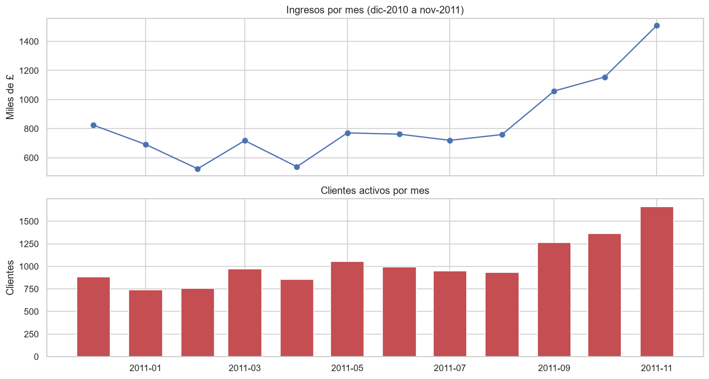
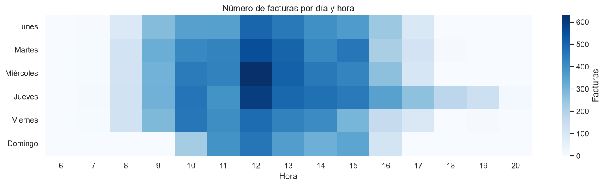
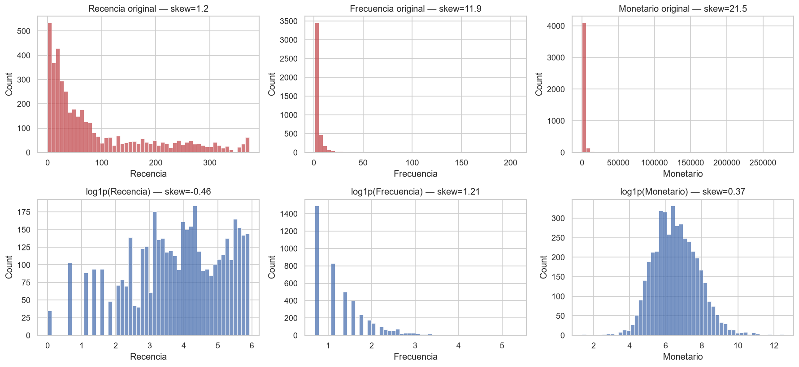
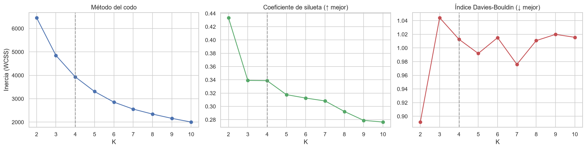
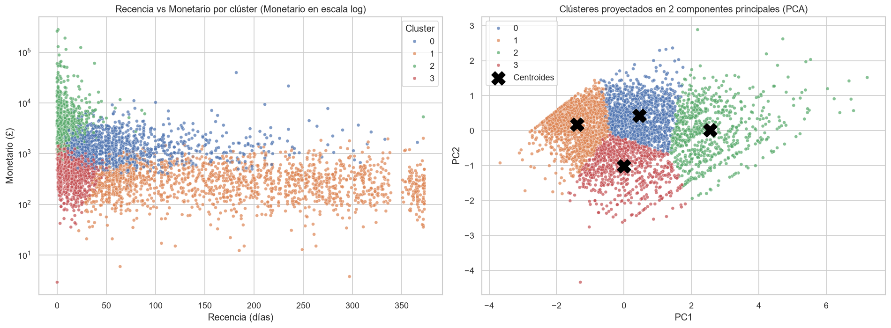
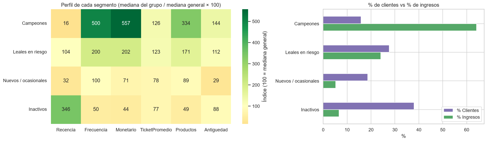

# 🛒 Segmentación de clientes de una tienda en línea con K-Means

**Proyecto integrador — Minería de datos**
Segmentación de datos con K-Means y desarrollo de un dashboard interactivo en Streamlit.

> **Integrantes:** _(escribir aquí el nombre de cada integrante)_

| | |
|---|---|
| **Temática** | Comercio electrónico / marketing analítico |
| **Dataset** | *Online Retail*, UCI Machine Learning Repository: 541,909 registros, 8 variables |
| **Algoritmo** | K-Means (Scikit-learn) sobre variables RFM |
| **Herramientas** | Python · Pandas · NumPy · Scikit-learn · Matplotlib · Seaborn · Streamlit · Plotly |
| **Resultado** | 4 segmentos de clientes + dashboard interactivo |

---

## 📁 Estructura del repositorio

```
├── app/
│   ├── dashboard.py                  # Punto de entrada del dashboard (menú de 2 páginas)
│   ├── comun.py                      # Carga de datos, paleta y estilo compartidos
│   ├── iconos.py                     # Iconos de Lucide (lucide.dev, licencia ISC)
│   ├── favicon.svg                   # Icono de la pestaña del navegador
│   └── paginas/
│       ├── analisis_general.py       # Página 1: análisis general del dataset
│       └── segmentacion.py           # Página 2: segmentación mediante K-Means
├── data/
│   ├── raw/online_retail.csv.gz      # Dataset original (convertido de .xlsx a CSV, sin cambios)
│   └── processed/
│       ├── clientes_segmentados.csv  # Un registro por cliente con variables RFM y su clúster
│       ├── resumen_segmentos.csv     # Tabla comparativa de los segmentos
│       ├── evaluacion_k.csv          # Métricas para K = 2 … 10
│       ├── ventas_limpias.csv.gz     # Líneas de venta limpias (para la página 1 del dashboard)
│       └── bitacora_limpieza.csv     # Registros antes y después de cada paso de limpieza
├── docs/
│   ├── JuliaExamen3.pdf              # Documento del proyecto (Parte 7)
│   └── capturas/                     # Capturas del dashboard
├── models/kmeans_rfm.joblib          # Scaler + modelo K-Means entrenado
├── notebooks/
│   └── proyecto_kmeans_clientes.ipynb  # Desarrollo completo (Partes 1 a 5), ya ejecutado
├── reports/figuras/                  # Gráficas exportadas por el notebook
├── scripts/descargar_datos.py        # Descarga el dataset desde UCI
├── .streamlit/config.toml            # Tema del dashboard
└── requirements.txt
```

## ▶️ Cómo ejecutar

```bash
# 1. Crear un entorno virtual e instalar dependencias
python -m venv .venv
.venv\Scripts\activate          # Windows  (en macOS/Linux: source .venv/bin/activate)
pip install -r requirements.txt

# 2. (Opcional) volver a ejecutar el análisis: regenera data/processed, models y reports
jupyter nbconvert --to notebook --execute --inplace notebooks/proyecto_kmeans_clientes.ipynb

# 3. Abrir el dashboard
streamlit run app/dashboard.py
```

El dataset ya está incluido en `data/raw/`. Si se quiere descargar de nuevo desde la fuente original:
`python scripts/descargar_datos.py`.

---

## Parte 1. Tema y planteamiento del problema

**Problema.** La tienda trata a todos sus clientes de la misma manera, aunque son muy diferentes: algunos
compran cada semana y gastan miles de libras, y otros compraron una sola vez hace meses. Sin segmentación, la
empresa no sabe a quién retener, a quién reactivar ni dónde invertir su presupuesto de marketing.

**Objetivo general.** Identificar segmentos de clientes con comportamiento de compra similar mediante
K-Means, a partir de Recencia, Frecuencia y Valor Monetario (RFM), y presentarlos en un dashboard interactivo
que apoye las decisiones comerciales.

**Objetivos específicos**
1. Depurar el registro de transacciones y transformarlo en un perfil por cliente.
2. Determinar el número óptimo de clústeres comparando K = 2 … 10 con el método del codo, la silueta y el
   índice Davies-Bouldin.
3. Caracterizar, nombrar y comparar cada segmento a partir de sus centroides y estadísticas.
4. Proponer recomendaciones comerciales por segmento.
5. Construir un dashboard con KPI, gráficas y filtros.

**Justificación.** Retener clientes cuesta menos que conseguir nuevos, y pocos clientes suelen concentrar la
mayoría de los ingresos. RFM es una técnica muy usada y fácil de explicar al área comercial; K-Means aporta
segmentos definidos por los datos en lugar de umbrales arbitrarios.

**Patrones esperados.** Clientes de alto valor, regulares que se están enfriando, nuevos u ocasionales, e
inactivos.

## Parte 2. Dataset y exploración

* **Fuente:** Chen, D. (2015). *Online Retail* [Dataset]. UCI Machine Learning Repository.
  <https://doi.org/10.24432/C5BW33>. Licencia CC BY 4.0.
* **Contenido:** 541,909 líneas de factura de una tienda en línea de Reino Unido (dic-2010 a dic-2011),
  con 8 variables: `InvoiceNo`, `StockCode`, `Description`, `Quantity`, `InvoiceDate`, `UnitPrice`,
  `CustomerID`, `Country`.
* Se importa con `pd.read_csv()`. Se muestran los primeros 10 registros, las dimensiones, los tipos de datos
  y las estadísticas descriptivas.
* **Calidad:** 135,080 registros sin `CustomerID` (25%), 1,454 sin descripción, 5,268 duplicados, 9,288
  líneas de cancelación y precios negativos o iguales a 0.
* **Gráficas exploratorias:** distribución de cantidad y precio, ingresos por país, evolución mensual y mapa
  de calor día × hora.

| | |
|---|---|
|  |  |

**Variables para el agrupamiento:** **Recencia** (días desde la última compra), **Frecuencia** (número de
facturas) y **Monetario** (gasto neto). Miden cuándo, cuántas veces y cuánto compra cada cliente.

## Parte 3. Limpieza y preparación

| Paso | Registros eliminados |
|---|---|
| Filas duplicadas | 5,268 |
| Registros sin `CustomerID` | 135,037 |
| Códigos que no son productos (envío, comisiones, ajustes) | 1,915 |
| Precio igual a 0 | 33 |
| Devoluciones (se separan para restarlas del gasto) | 8,506 |
| **Líneas de venta válidas** | **391,150** |

* **Inconsistencias corregidas:** mayúsculas/minúsculas en códigos, 210 productos con varias descripciones,
  países no estandarizados (`EIRE`, `RSA`, `Unspecified`), 8 clientes con más de un país y residuos de punto
  flotante en el gasto neto.
* **Tipos:** `InvoiceDate` → `datetime`, `CustomerID` → entero.
* **Tabla por cliente:** 4,334 clientes; se excluyen 14 con gasto neto ≤ 0 → **4,320 clientes**.
* **Atípicos (IQR):** 6–10% en Frecuencia y Monetario. Se **conservan**, porque son los mejores clientes, y
  se aplica `log1p` para reducir la asimetría (Monetario: de 21.5 a 0.4).
* **Codificación:** one-hot de la región, solo para el análisis. Las variables categóricas no entran al
  modelo porque distorsionan la distancia euclidiana.
* **Escalamiento:** `StandardScaler` (media 0, desviación 1).



## Parte 4. K-Means

Se evaluó K = 2 … 10 con `KMeans(init="k-means++", n_init=10, random_state=42)`:



**K = 4** porque:
* El codo está en K = 4: después de K = 4 cada clúster adicional reduce cada vez menos la inercia.
* Su silueta (0.34) es igual a la de K = 3 y su índice Davies-Bouldin es mejor.
* Da cuatro segmentos accionables. K = 2 tiene la silueta más alta, pero solo separa clientes "buenos" y
  "malos".

El modelo final asigna los clústeres con `fit_predict()`. Los centroides se devuelven a unidades originales
con `inverse_transform` + `expm1`.



**Comparación de configuraciones**

| | A: log + StandardScaler (elegida) | B: solo StandardScaler |
|---|---|---|
| Silueta | 0.34 | 0.61 |
| Tamaño de los clústeres | 685 – 1,640 | **6** – 3,137 |
| Interpretación | 4 perfiles distintos y útiles | 2 clústeres solo aíslan a los clientes extremos |

La silueta alta de B es engañosa: sin el logaritmo, los valores extremos dominan la distancia y K-Means se
dedica a separar a unos pocos megaclientes. Una métrica aislada no basta para elegir el modelo.

## Parte 5. Resultados

| Segmento | Clientes | % ingresos | Recencia mediana | Compras (mediana) | Gasto mediano |
|---|---|---|---|---|---|
| 🏆 **Campeones** | 685 (15.9%) | **64.1%** | 8 días | 10 | £3,623 |
| ⚠️ **Leales en riesgo** | 1,192 (27.6%) | 24.0% | 52 días | 4 | £1,313 |
| 🌱 **Nuevos / ocasionales** | 803 (18.6%) | 5.2% | 16 días | 2 | £461 |
| 💤 **Inactivos** | 1,640 (38.0%) | 6.6% | 173 días | 1 | £289 |



**Hallazgos**
1. El ingreso está muy concentrado: el 16% de los clientes (Campeones) genera el 64% de los ingresos.
2. Los Leales en riesgo aportan casi £2 M (24%), pero llevan una mediana de 52 días sin comprar.
3. La retención es el mayor problema: el 38% de los clientes está inactivo y el 35% compró una sola vez.
4. Los clientes Nuevos compraron hace poco: es el mejor momento para conseguir su segunda compra.
5. El comportamiento es mayorista (B2B): compran de lunes a viernes en horario laboral.

**Recomendaciones**
1. **Campeones:** programa VIP (ejecutivo de cuenta, descuentos por volumen, acceso anticipado a la
   temporada navideña).
2. **Leales en riesgo:** campaña de reactivación antes de cumplir 60 días sin compra.
3. **Nuevos:** secuencia de bienvenida con incentivo para la segunda compra.
4. **Inactivos:** recuperación automatizada de bajo costo y salida de las campañas caras.
5. **General:** asignar el presupuesto según el valor del segmento, crear alertas de recencia y reentrenar
   el modelo cada trimestre.

**Limitaciones:** datos de un solo año y de 2010-2011; se excluyó el 25% de las transacciones (sin cliente);
K-Means supone clústeres esféricos y es sensible a los atípicos; la silueta moderada indica clientes en las
fronteras entre segmentos; solo se usaron variables RFM; el modelo describe, pero no predice el abandono.

## Parte 6. Dashboard interactivo (Streamlit)

`streamlit run app/dashboard.py`

El dashboard tiene **dos páginas**, que se eligen en el menú de la barra lateral. Cada una tiene sus propios filtros, y todas sus visualizaciones se calculan con los datos y archivos generados en Python.

**Página 1. Análisis general** (`app/paginas/analisis_general.py`): indicadores, estadísticas y visualizaciones generales del dataset limpio.

| Elemento | Implementación |
|---|---|
| Filtros (3) | Periodo (meses), región y país |
| 5 KPI | Ingresos, facturas, clientes, valor promedio por factura y productos distintos |
| Gráficas | Ingresos y clientes por mes, top 10 de países y de productos, facturas por día y hora, y distribución del valor de las facturas |
| Tablas | Estadísticas descriptivas de las ventas y bitácora de limpieza (con gráfica de registros por paso) |

**Página 2. Segmentación mediante K-Means** (`app/paginas/segmentacion.py`): agrupamientos, características de los clústeres, comparaciones y resultados del modelo.

| Requisito | Implementación |
|---|---|
| Título | "Segmentación de clientes de una tienda en línea con K-Means" |
| 4 KPI | Clientes, ingresos netos, ticket promedio por compra y recencia mediana |
| Distribución por clúster | Barras horizontales con número y % de clientes |
| Dispersión | Ejes seleccionables, color y símbolo por segmento, escala log |
| 2+ gráficas comparativas | Boxplot por variable, % clientes vs % ingresos y mapa de calor del perfil |
| Tabla de estadísticas | Media, mediana, desviación, mínimo y máximo por clúster, con variables seleccionables |
| Filtros (5) | Segmento, región, país, rango de gasto y rango de recencia |
| Resultados del modelo | Método del codo, silueta, centroides en unidades originales y configuración elegida |
| Descripción de los grupos | Una tarjeta por segmento con sus métricas |
| Hallazgos y recomendaciones | Sección con cifras calculadas a partir de los datos |
| Extra | Descarga en CSV de los clientes filtrados |
